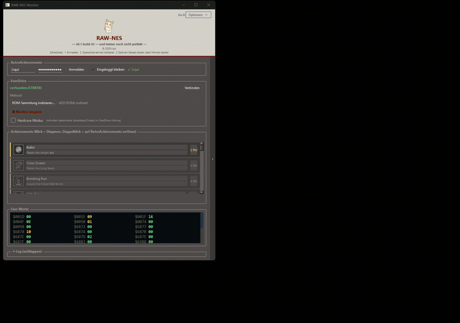

# RAW-NES

[English](README.md) | Deutsch

**[Projektseite und Downloads &rarr;](https://liquid-wq.github.io/raw-nes/)**

RetroAchievements auf einem echten NES, über USB von einem EverDrive N8 PRO.
Ohne Emulator.

Eigene FPGA-Kerne auf dem EverDrive verfolgen die NES-CPU und führen Buch
über den Arbeitsspeicher der Konsole. RAW-NES liest diese Werte über USB,
wertet die Bedingungen von RetroAchievements am PC aus und schaltet
Achievements frei, während du auf Originalhardware spielst.

---

## Neu in 3.0.0

* **Eine einzige Programmdatei.** Keine Installation, keine
  Laufzeitbibliotheken. Die FPGA-Kerne sind eingebaut und werden aus dem
  Programm heraus auf die SD-Karte gebracht.
* **Exakte Spielerkennung.** RAW-NES fragt das EverDrive, welche Datei
  gestartet wurde, und erkennt das Spiel an seinem RetroAchievements-Hash.
  Es wählt immer selbst das richtige Spiel.
* **Jedes Bild zählt.** Die neuen Kerne liefern die Werte jedes einzelnen
  Bildes. Auch kürzeste Ereignisse werden erfasst, und Werte aus
  verschiedenen Bildern werden nie vermischt.
* **Sichere Freischaltungen.** Ausgewertet wird nur, solange wirklich ein
  Spiel läuft. Konsole ausschalten oder ein Spiel verlassen löst nie etwas aus.
* **Startet von selbst.** RAW-NES verbindet sich selbst mit dem EverDrive und
  beginnt die Überwachung, sobald ein Spiel läuft. Die Statuszeile zeigt, ob
  die Konsole aus ist, im EverDrive-Menü steht oder überwacht wird.
* **Sieben Sprachen:** Englisch, Deutsch, Spanisch, Portugiesisch (Brasilien),
  Französisch, Italienisch, Polnisch.

---

## Voraussetzungen

* NES oder kompatible Konsole
* EverDrive N8 PRO mit USB-Kabel zum PC
* Windows 64-Bit
* Ein RetroAchievements-Konto

---

## Erste Schritte

1. Release herunterladen und entpacken.
2. `raw-nes.exe` starten. Die Ersteinrichtung fragt nach der Sprache und
   bringt die FPGA-Kerne auf die SD-Karte des EverDrive.
3. Bei RetroAchievements anmelden.
4. SD-Karte zurück ins EverDrive und ein Spiel über das EverDrive-Menü
   starten. RAW-NES erkennt es und beginnt die Überwachung.

Unterstützte Mapper-Gruppen: NROM und ähnliche (000), MMC1 und weitere (001),
MMC3 (004), MMC5 (005), Konami VRC (021).

Der Hardcore-Modus ist geplant, aber noch nicht aktiv: Freischaltungen
zählen als Softcore, Leaderboard-Einträge werden nicht eingereicht.

---

## Ältere Fassungen

Die Qt-Fassung (2.x) und die Python-Fassung liegen nur noch zum Nachlesen in
[`legacy/`](legacy/). Sie werden nicht mehr gepflegt. Bitte 3.0.0 verwenden.

---

## Fehler melden

Nur über GitHub Issues, mit Spielname, Version und dem Log aus dem
Programmfenster ("Log kopieren").

---

## Lizenz

Quelltext einsehbar, nicht Open Source. Siehe [`LICENSE`](LICENSE).
Fremdkomponenten und ihre Lizenzen stehen in
[`THIRD-PARTY-NOTICES.txt`](THIRD-PARTY-NOTICES.txt).

Gebaut von Liqui.
