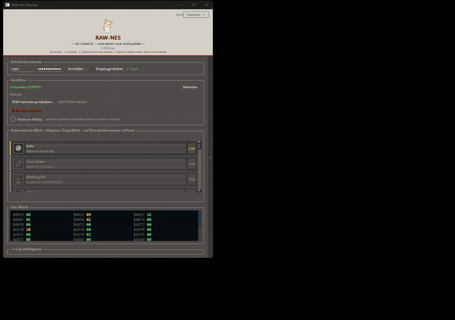

# RAW-NES

English | [Deutsch](README.de.md)

**[Project page and downloads &rarr;](https://liquid-wq.github.io/raw-nes/)**

RetroAchievements on a real NES, over USB from an EverDrive N8 PRO.
No emulator involved.

Custom FPGA cores on the EverDrive follow the NES CPU and keep track of the
console's RAM. RAW-NES reads those values over USB, evaluates the
RetroAchievements condition sets on the PC, and unlocks achievements while
you play on original hardware.

---

## What's new in 3.0.0

* **One program file.** No installation, no runtime libraries. The FPGA
  cores are built in and set up onto the SD card from inside the program.
* **Exact game detection.** RAW-NES asks the EverDrive which file was
  started and identifies the game by its RetroAchievements hash. It always
  picks the right game on its own.
* **Every frame counts.** The new cores hand over the values of every single
  frame, so even the shortest events are caught and values from different
  frames are never mixed.
* **Safe unlocks.** Achievements are only evaluated while a game is
  actually running. Switching the console off or leaving a game never
  triggers anything.
* **Starts by itself.** RAW-NES connects to the EverDrive on its own and
  starts monitoring as soon as a game runs. The status line shows whether
  the console is off, in the EverDrive menu, or being monitored.
* **Seven languages:** English, German, Spanish, Portuguese (Brazil), French,
  Italian, Polish.

---

## Requirements

* NES or compatible console
* EverDrive N8 PRO with a USB cable to the PC
* Windows 64-bit
* A RetroAchievements account

---

## Getting started

1. Download the release and unpack it.
2. Start `raw-nes.exe`. The first-run setup asks for your language and
   installs the FPGA cores onto the EverDrive SD card.
3. Log in to RetroAchievements.
4. Put the SD card back into the EverDrive and start a game from the
   EverDrive menu. RAW-NES detects it and starts monitoring.

Supported mapper groups: NROM and similar (000), MMC1 and others (001),
MMC3 (004), MMC5 (005), Konami VRC (021).

Hardcore mode is planned but not active yet: unlocks are recorded as
softcore, and leaderboard entries are not submitted.

---

## Older versions

The Qt version (2.x) and the Python version are kept in
[`legacy/`](legacy/) for reference only. They are no longer maintained.
Please use 3.0.0.

---

## Building

The source is published so you can see what the program does. To build it
yourself you need MinGW-w64, CMake, Ninja, Dear ImGui, miniz and
nlohmann/json; see [`CMakeLists.txt`](CMakeLists.txt).

---

## Reporting bugs

GitHub Issues only, with the game name, the version, and the log from the
program window ("Copy log").

---

## License

Source-available, not open source. See [`LICENSE`](LICENSE). Third-party
components and their licenses are listed in
[`THIRD-PARTY-NOTICES.txt`](THIRD-PARTY-NOTICES.txt).

Built by Liqui.
